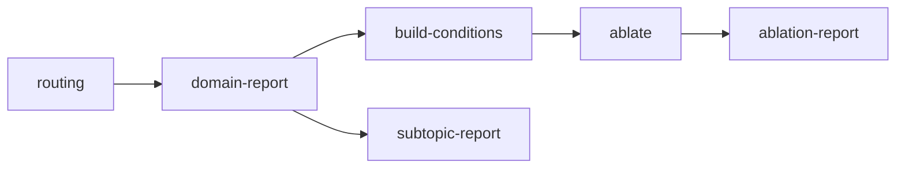

# Architecture and correctness contracts

All application code lives under `src/moe_pilot/`. `Experiment` is the immutable,
validated definition of a run; `ExperimentRunner` is its orchestration API.
The CLI loads the same definition and calls that API. There are no compatibility
wrappers, legacy command aliases, or implicit relative-file execution paths.

## Configuration and paths

`load_experiment(filename)` parses schema version 1 TOML, rejects unknown
settings and invalid parameter types, and resolves paths against the config
file's directory. Parsing creates no directories or model instances. The
library's `Paths` constructor accepts absolute paths only. Model, data, and
outputs have distinct responsibilities; output paths cannot contain or be
contained by model/data paths.

| Location                       | Responsibility                                                   |
| ------------------------------ | ---------------------------------------------------------------- |
| `paths.model`                  | Immutable local checkpoint, tokenizer, and model revision record |
| `paths.data`                   | Analysis, held-out, and subtopic JSON corpora and source records |
| `paths.output/artifacts`       | Routing, geometry, and probe arrays                              |
| `paths.output/tables`          | Domain, ablation, and subtopic CSV tables                        |
| `paths.output/figures`         | Exported research figures                                        |
| `paths.output/ablations`       | Explicit condition definitions and inference checkpoints         |
| `paths.output/experiment.json` | Configuration, stage state, identities, and output hashes        |

The TOML groups execution parameters, statistical analysis settings, ablation
counts/control search, corpus sample counts, and pinned download revisions.
With no analysis layers specified, reports select the first, middle, and last
model layers. Explicit layer indices are validated against the actual model.

## Module boundaries

| Module                        | Responsibility                                           |
| ----------------------------- | -------------------------------------------------------- |
| `config.py`                   | Frozen settings, validation, explicit path layout        |
| `experiment.py`               | Stage graph, writer lock, manifests, reuse/invalidation  |
| `engine.py`                   | Device-aware attention, expert routing, and token losses |
| `devices.py`                  | Backend selection, capability probes, host array transfer |
| `resources.py`                | Shared-host admission checks and per-process allocator limits |
| `model.py`                    | Local configuration and safetensors tensor access        |
| `checkpoints.py`              | Atomic arrays and inference resume identities            |
| `probes.py`                   | Read-only geometry observer of the shared engine         |
| `benchmark.py`                | Repeated synchronized engine measurements and parity checks |
| `observations.py`             | Document-level routing, norms, features, and target losses |
| `acquisition.py`, `catalog.py` | Immutable local checkpoints and declared model lineages |
| `publication.py`              | Evidence validation and generated local research reports |
| `plotting.py`                 | Headless figures without process-wide plotting state     |
| `interventions.py`            | Versioned, validated specialist/control metadata         |
| `perturbations.py`            | Immutable mode, strength, expert mask, and donor semantics |
| `verification.py`             | Full-depth local checkpoint checks against Transformers |
| `controls.py`                 | Specialist ranking and routing-mass matching             |
| `corpora.py`, `datasets.py`   | Seeded sampling and pinned source downloads              |
| `metrics.py`, `statistics.py` | Probability metrics and document-level inference         |
| `artifacts.py`                | Corpus validation and atomic JSON writes                 |
| `workflows/`                  | Configured stages returning explicit output paths        |
| `cli.py`                      | Arguments, CLI CPU-thread policy, and API invocation     |

Imports never download data, load model weights, or start experiments. Optional
dataset dependencies are imported only by source-download workflows. The CLI
sets the configured CPU-thread count; library embedding leaves process-wide
thread policy with the caller. Engine objects own independent local model state.
The benchmark API temporarily applies its explicit thread setting and restores
the caller's setting on success or failure.

## Compute device selection

`execution.device` defaults to `auto`. The runner resolves one device for its
stages and passes that exact selection into every engine. Standalone library
callers use `Engine(model_directory, device="auto")`. Selection tries CUDA/ROCm
GPU indices before MPS and reaches CPU only after accelerator checks fail.
Explicit `cuda[:index]`, `rocm[:index]`, `mps`, and `cpu` requests fail clearly
if that backend is unavailable or noncompliant; they do not silently switch.

[ROCm uses PyTorch's CUDA API](https://docs.pytorch.org/docs/stable/notes/hip.html):
`torch.version.hip` distinguishes an AMD build, whose tensor device is still
`cuda:N`. CUDA and ROCm are distinct wheel builds. The default package source
supports NVIDIA CUDA on Linux and native MPS on macOS; AMD installs use the
locked `rocm` extra. CPU-only Linux wheels are an optional `cpu` extra.

Availability alone is insufficient. A synchronized numerical probe checks the
float32 attention, RMS/router, indexed accumulation, geometry, and loss kernels
used by inference against CPU reference results. A failed candidate is recorded,
and automatic selection continues to the next accelerator before CPU.
The project does not globally enable MPS's per-operation CPU fallback.

Weights and temporary activations use the selected device. Disk reads, compact
batch/document metadata, and persisted NumPy arrays are host-side. Checkpoint
hidden states are saved on the host and restored to the selected compute device.
Geometry uses a private host RNG and transfers random tensors to that device;
it does not depend on MPS supporting `torch.Generator`.

`execution.weight_cache` is `stream` by default. The explicit `resident` policy
caches tensors lazily on the compute device for repeated passes. It retains the
same float32 values and arithmetic, requires adequate memory, and records its
policy in configuration/checkpoint identities. Embedding rows are gathered on
the host, so the full embedding table is not cached. An engine rejects changed
model shards or configuration after construction. A failed allocation remains
an error; the engine does not silently change its cache or device policy.

`ResourcePolicy` admits estimates before loading weights, preserves free host
memory, limits this process's accelerator allocator, and rechecks between
layers. Engine calls, explicit reference verification, and benchmarks share a
per-user compute lease. Budget failures stop execution without switching to
CPU. See the [resource policy](runbook.md#shared-workstation-resource-policy).

`Batch.limit` preserves the requested token cap while `Batch.T` is the actual
longest retained document. Padding uses the latter to avoid allocating context
windows larger than the observations require. Checkpoints retain both values.
Study observations can also use `execution.microbatch_documents`, with fixed
document/answer mapping and deterministic probe samples across batch sizes.

Backend, concrete device, device name, platform, CUDA/HIP build versions, and
float32 precision are included in runtime identity. Stage records also preserve
rejected candidates and the requested policy. Moving from CPU to MPS/CUDA/ROCm,
or between GPU indices, invalidates stage/checkpoint reuse. Selection is fixed
for an invocation; errors during a long experiment are propagated rather than
silently recomputing partial results on another backend.

## Experiment lifecycle



Corpus construction and explicit model download precede this graph. Supplied
corpus JSON files can be used directly without rerunning builders. Stage reuse
requires a completed record, matching source/input identities and numerical
dependency versions, valid output hashes, and recursively valid dependencies.
An output directory is bound to one configuration. Failed/interrupted steps
cannot feed reports, and input changes during execution invalidate that step.
A process-safe file lock admits a single writer per experiment.

Model identity includes configuration/tokenizer JSON contents and local shard
sizes/mtime. This guards ordinary local changes without repeatedly reading GBs
of weights. It is not a cryptographic attestation of every model byte. Use
immutable downloaded revisions and preserve the model snapshot for research.

Routing and geometry share `Engine.run`; an `OrthogonalityProbe` observes the
same per-layer expert inputs. It has a private RNG and does not replace the
engine's attention/router computations. New routing probabilities and selected
weights retain float32 precision. The frozen reconstruction used its recorded
float16 artifact schema; its original source remains with the run.

## Interventions and statistics

Condition JSON schema 2 explicitly stores model dimensions, domain, scope,
expert count, family, mask, seed, and specialist parent. Reports never infer
meaning from names. Both global-mass and on-domain-mass controls are generated
with specialists, so report generation is not a prerequisite for controls.
Specialists are ranked from measured routing distributions; no expert IDs,
domain names, model depth, or expert count are hard-coded into execution.
Condition definitions and ablation summaries include masked routing masses so
control-matching quality remains inspectable alongside the loss contrasts.

Each condition also records mode, strength, and donor mapping. The engine accepts
only explicit immutable `Intervention` objects. `reroute` excludes target experts
before softmax/top-k. `remove` attenuates their original selected contributions
without replacements. `rescale` additionally restores the original total gate
mass; if every contribution is removed its defined output is zero. `substitute`
evaluates declared donor experts on the same inputs with the target gate values.
Partial rerouting/substitution blends original and transformed expert outputs.
Zero strength reproduces baseline inference.

Fixed routing refers to the unperturbed router at each target site's incoming
states. Earlier interventions can change later hidden states and hence later
router choices. It does not globally freeze all baseline routes. Optional
intervention callbacks and checkpoint diagnostics expose affected-token counts,
gate masses, expert-set changes, and output changes. For partial rerouting and
substitution, gate diagnostics describe the transformed branch before blending.
Checkpoint signatures include complete intervention semantics; mode, strength,
or donor changes cannot reuse a prior condition. Missing requested diagnostics
cause recomputation rather than accepting incomplete observation artifacts.

The engine always returns a baseline. Each document's final token has zero loss
and `valid=False`; apply that mask before averaging. Empty engine conditions
reproduce the baseline. Rerouting must leave at least top-k experts available.
The condition builder also requires equally sized disjoint control masks.
Held-out evaluation rejects texts overlapping the analysis corpus.

Losses are nats per token. Domain/subtopic entropy and JSD are bits. Ablation
tables distinguish token-weighted means from equal-document means. Confidence
intervals are paired document bootstraps with unadjusted 95% coverage; they do
not imply multiple-comparison correction or broad claims of expert necessity.
Unused experts have undefined conditional probabilities/SI (`NaN`), aggregate
statistics exclude those undefined values, and heatmaps use neutral lift.

## Engine API

```python
from moe_pilot.engine import Engine
from moe_pilot.perturbations import Intervention


def compare_documents(model_directory, documents):
    engine = Engine(model_directory)
    batch = engine.batch([engine.tok(text).input_ids for text in documents], 64)
    losses, valid, routing = engine.run(
        batch, {"masked": Intervention({0: [1]}, mode="remove")}, log_routing=True
    )
    return {name: float(values[valid].mean()) for name, values in losses.items()}
```

The engine supports standard OLMoE multi-head attention, SiLU, default unscaled
RoPE, optional QKV clipping, and both top-k normalization settings. It accepts
sharded or single-file safetensors with per-expert or packed expert tensors.
Unsupported attention bias, grouped-query attention, scaled RoPE, or activation
types fail explicitly. Layer streaming reduces resident weight memory; hidden
states and optional geometry probes still require substantial RAM.

Use `ExperimentRunner` for public workflow orchestration and provenance. Low-level
`workflows.*.run(config)` functions are stage implementations; bypassing the
runner bypasses dependency and provenance checks. Reusable application logic
belongs in package modules and verification in checked-in tests, never inline
Python commands or root-level scripts.
