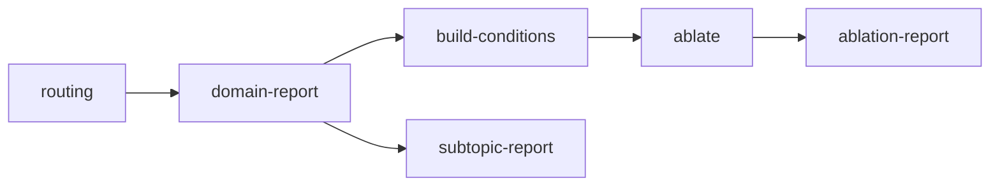

# Architecture and correctness contracts

All application code lives under `src/moe_pilot/`. `Experiment` is the immutable,
validated definition of a run; `ExperimentRunner` is its orchestration API.
The CLI loads the same definition and calls that API. There are no compatibility
wrappers, legacy command aliases, or implicit relative-file execution paths.

## Configuration and paths

`load_experiment(filename)` parses schema version 1 TOML, rejects unknown
settings and invalid parameter types, and resolves paths against the config
file's directory. Parsing creates no directories or model instances. The
library's `Paths` constructor accepts absolute paths only. Model, data, and
outputs have distinct responsibilities; output paths cannot contain or be
contained by model/data paths.

| Location                       | Responsibility                                                   |
| ------------------------------ | ---------------------------------------------------------------- |
| `paths.model`                  | Immutable local checkpoint, tokenizer, and model revision record |
| `paths.data`                   | Analysis, held-out, and subtopic JSON corpora and source records |
| `paths.output/artifacts`       | Routing, geometry, and probe arrays                              |
| `paths.output/tables`          | Domain, ablation, and subtopic CSV tables                        |
| `paths.output/figures`         | Exported research figures                                        |
| `paths.output/ablations`       | Explicit condition definitions and inference checkpoints         |
| `paths.output/experiment.json` | Configuration, stage state, identities, and output hashes        |

The TOML groups execution parameters, statistical analysis settings, ablation
counts/control search, corpus sample counts, and pinned download revisions.
With no analysis layers specified, reports select the first, middle, and last
model layers. Explicit layer indices are validated against the actual model.

## Module boundaries

| Module                        | Responsibility                                           |
| ----------------------------- | -------------------------------------------------------- |
| `config.py`                   | Frozen settings, validation, explicit path layout        |
| `experiment.py`               | Stage graph, writer lock, manifests, reuse/invalidation  |
| `engine.py`                   | CPU attention, expert routing, batches, and token losses |
| `model.py`                    | Local configuration and safetensors tensor access        |
| `checkpoints.py`              | Atomic arrays and inference resume identities            |
| `probes.py`                   | Read-only geometry observer of the shared engine         |
| `plotting.py`                 | Headless figures without process-wide plotting state     |
| `interventions.py`            | Versioned, validated specialist/control metadata         |
| `controls.py`                 | Specialist ranking and routing-mass matching             |
| `corpora.py`, `datasets.py`   | Seeded sampling and pinned source downloads              |
| `metrics.py`, `statistics.py` | Probability metrics and document-level inference         |
| `artifacts.py`                | Corpus validation and atomic JSON writes                 |
| `workflows/`                  | Configured stages returning explicit output paths        |
| `cli.py`                      | Arguments, CLI CPU-thread policy, and API invocation     |

Imports never download data, load model weights, or start experiments. Optional
dataset dependencies are imported only by source-download workflows. The CLI
sets the configured CPU-thread count; library embedding leaves process-wide
thread policy with the caller. Engine objects own independent local model state.

## Experiment lifecycle



Corpus construction and explicit model download precede this graph. Supplied
corpus JSON files can be used directly without rerunning builders. Stage reuse
requires a completed record, matching source/input identities and numerical
dependency versions, valid output hashes, and recursively valid dependencies.
An output directory is bound to one configuration. Failed/interrupted steps
cannot feed reports, and input changes during execution invalidate that step.
A process-safe file lock admits a single writer per experiment.

Model identity includes configuration/tokenizer JSON contents and local shard
sizes/mtime. This guards ordinary local changes without repeatedly reading GBs
of weights. It is not a cryptographic attestation of every model byte. Use
immutable downloaded revisions and preserve the model snapshot for research.

Routing and geometry share `Engine.run`; an `OrthogonalityProbe` observes the
same per-layer expert inputs. It has a private RNG and does not replace the
engine's attention/router computations. Full router probabilities and selected
weights are stored in float16; losses and computation use float32.

## Interventions and statistics

Condition JSON explicitly stores its schema, model dimensions, domain, scope,
expert count, family, mask, seed, and specialist parent. Reports never infer
meaning from names. Both global-mass and on-domain-mass controls are generated
with specialists, so report generation is not a prerequisite for controls.
Specialists are ranked from measured routing distributions; no expert IDs,
domain names, model depth, or expert count are hard-coded into execution.
Condition definitions and ablation summaries include masked routing masses so
control-matching quality remains inspectable alongside the loss contrasts.

The engine always returns a baseline. Each document's final token has zero loss
and `valid=False`; apply that mask before averaging. Empty engine conditions
reproduce the baseline. Conditions must leave at least top-k experts available.
The condition builder also requires equally sized disjoint control masks.
Held-out evaluation rejects texts overlapping the analysis corpus.

Losses are nats per token. Domain/subtopic entropy and JSD are bits. Ablation
tables distinguish token-weighted means from equal-document means. Confidence
intervals are paired document bootstraps with unadjusted 95% coverage; they do
not imply multiple-comparison correction or broad claims of expert necessity.
Unused experts have undefined conditional probabilities/SI (`NaN`), aggregate
statistics exclude those undefined values, and heatmaps use neutral lift.

## Engine API

```python
from moe_pilot.engine import Engine


def compare_documents(model_directory, documents):
    engine = Engine(model_directory)
    batch = engine.batch([engine.tok(text).input_ids for text in documents], 64)
    losses, valid, routing = engine.run(batch, {"masked": {0: [1]}}, log_routing=True)
    return {name: float(values[valid].mean()) for name, values in losses.items()}
```

The engine supports standard OLMoE multi-head attention, SiLU, default unscaled
RoPE, optional QKV clipping, and both top-k normalization settings. It accepts
sharded or single-file safetensors with per-expert or packed expert tensors.
Unsupported attention bias, grouped-query attention, scaled RoPE, or activation
types fail explicitly. Layer streaming reduces resident weight memory; hidden
states and optional geometry probes still require substantial RAM.

Use `ExperimentRunner` for public workflow orchestration and provenance. Low-level
`workflows.*.run(config)` functions are stage implementations; bypassing the
runner bypasses dependency and provenance checks. Reusable application logic
belongs in package modules and verification in checked-in tests, never inline
Python commands or root-level scripts.
