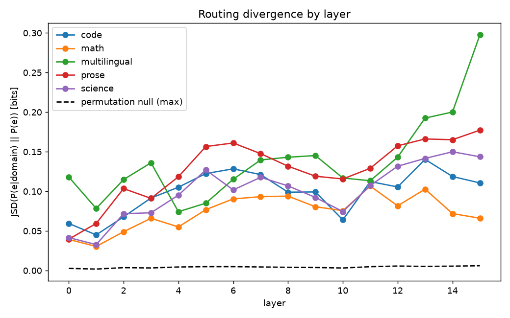
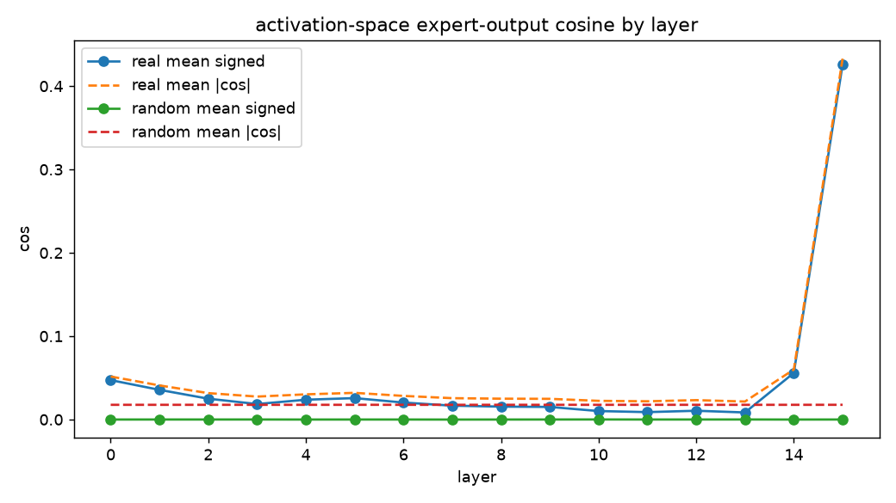
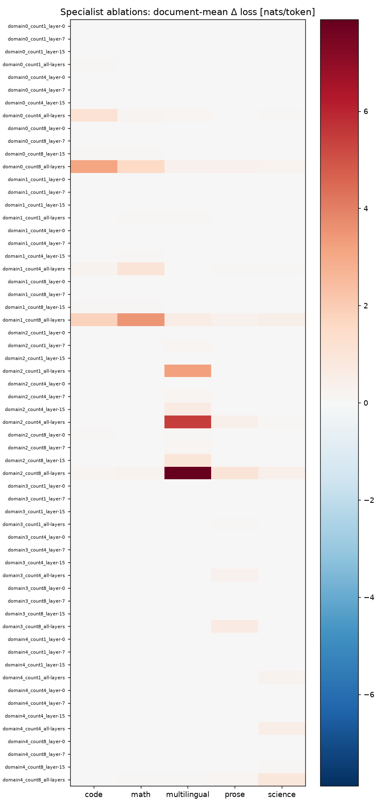

# Reconstruction methods and analysis

## Model and execution

Repository: `allenai/OLMoE-1B-7B-0924`. Revision:
`6d84c48581ece794365f2b8e9cfb043c68ade9c5`. All 16 decoder layers are evaluated;
top-8 experts are selected per token. The recorded device is
`mps` and inference is
float32. Configuration and version/source identities are in [evidence.json](evidence.json).

The discovery corpus is used for routing distributions and specialist selection.
Held-out documents are evaluated for ablation deltas. The original inputs and
fixed sample settings are retained; this reconstruction is distinct from the
new source-balanced confirmatory study. Input files, archived source records,
and all generated output hashes are validated before publication.

## Baseline and domain routing

| domain | documents | valid_targets | mean_loss_nats_per_token |
| --- | --- | --- | --- |
| code | 100 | 6277 | 1.81323 |
| math | 100 | 6254 | 1.86404 |
| multilingual | 100 | 5597 | 2.44842 |
| prose | 100 | 6300 | 2.51714 |
| science | 100 | 5094 | 2.02143 |

Loss averages weight valid next-token targets. Each document's final token is
excluded. Domain-routing divergence at the final layer is measured in bits:

| domain | jsd_vs_overall | jsd_null_mean | jsd_null_max | effective_experts |
| --- | --- | --- | --- | --- |
| code | 0.110604 | 0.00265486 | 0.00548803 | 31.2946 |
| math | 0.0660169 | 0.0018742 | 0.00450598 | 37.0602 |
| multilingual | 0.297647 | 0.00252951 | 0.00467089 | 19.6912 |
| prose | 0.177228 | 0.001891 | 0.00458089 | 48.7612 |
| science | 0.143663 | 0.00224662 | 0.00604282 | 41.5104 |

The configured 20 document-label permutations
provide descriptive null summaries. The largest sampled null is not a
multiple-comparison-adjusted significance threshold. Token identity/category
diagnostics are retained in the full tables and figures.

## Expert geometry

The layer-average centered expert-output absolute cosine is 0.019041.
Full weight and output comparisons with Gaussian/norm-matched controls are in
[orthogonality_by_layer.csv](tables/orthogonality_by_layer.csv) and
[activation_orthogonality.csv](tables/activation_orthogonality.csv).

| space | kind | mean_abs_cos | mean_signed_cos |
| --- | --- | --- | --- |
| activation | random | 0.0176389 | -5.00269e-06 |
| activation | real | 0.0562201 | 0.0477042 |
| weight | random | 0.000552027 | -6.64704e-07 |
| weight | real | 0.00208022 | 0.00167522 |

These are descriptive similarities on sampled inputs. Flattened weight cosine
is sensitive to internal neuron permutations and high-dimensional geometry;
it does not measure causal independence or distinct knowledge.

## Held out interventions and matching

The reconstruction excludes target experts before softmax/top-k. It allows
replacement experts and changes gate weights. Its loss deltas therefore measure
exclusion with rerouting. New fixed-routing modes are tested separately.
Specialists and both control families are represented in
[the complete ablation summary](tables/ablations/ablation_summary.csv).

| domain | specialist_on_domain_delta | control_on_domain_delta | paired_difference | ci95_low | ci95_high | relative_mass_gap |
| --- | --- | --- | --- | --- | --- | --- |
| code | 0.00276492 | 0.00157987 | 0.00118505 | -0.0013687 | 0.00405392 | 0.221602 |
| math | 0.00183747 | 0.00109542 | 0.000742047 | -0.003433 | 0.00544073 | 0.578376 |
| multilingual | 0.132764 | 0.000270357 | 0.132493 | 0.0961961 | 0.17143 | 0.927075 |
| prose | -0.000174055 | 0.000474944 | -0.000648999 | -0.00330995 | 0.00199414 | 0.449959 |
| science | 0.00776867 | 0.00017773 | 0.00759094 | 0.00223233 | 0.013344 | 0.62523 |

Displayed contrasts use selected layer 7 and one expert, without
selecting rows for their observed effect. Relative mass gap is the absolute
specialist-minus-mean-control mass divided by specialist mass. Controls can
have substantial residual imbalance. Confidence intervals use
2000 paired document bootstrap samples
and are unadjusted. The configured 3 control
draws are not independent trained models.

## Subtopic observations

The separate subtopic corpus is evaluated across its declared groups.
Final-layer within-domain and between-domain routing divergences are:

| domain | within_domain_pair_jsd | within_null_mean | between_domain_subtopic_pair_jsd |
| --- | --- | --- | --- |
| math | 0.0348362 | 0.00355171 | 0.374148 |
| code | 0.0595661 | 0.00260554 | 0.374148 |
| science | 0.0441088 | 0.00280368 | 0.374148 |
| multilingual | 0.160556 | 0.00327381 | 0.374148 |

Subject, source, and language can contribute to these differences. The
subtopic analysis does not by itself isolate semantic domain expertise.

## Reproduction and interpretation

The run's input/source records and output checksums are in the evidence
inventory. Small CSV, JSON, and PNG artifacts are exported alongside this
analysis; large raw arrays and per-token checkpoints remain in the local run
with their hashes retained. The frozen runtime's source files are validated
without substituting the currently installed implementation.

The appropriate findings are measured routing/geometry patterns and conditional
intervention effects in this sample. The source-balanced causal study addresses
remaining source, lexical, intervention, and matching questions. Neither
reconstruction nor synthetic performance establishes general reasoning quality.
